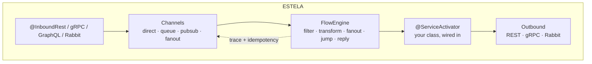
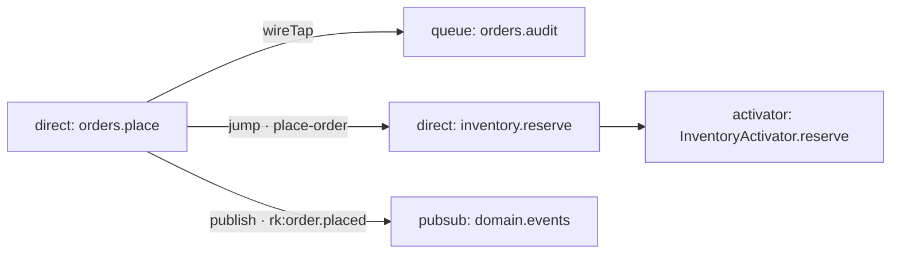

<div align="center">
  

  **The Enterprise Integration Patterns runtime for NestJS.**
  *The flow talks to channels, not to classes.*

  [](#status)
  [](#architecture)
  [](#installation)
  [](#installation)
  [](#license)
  [](https://www.dyddtech.com)
  [](https://www.linkedin.com/in/eliudiaz)
  [](https://github.com/eliudiaz-dydd)

  **English** · [Español](./README.es.md) · [Português](./README.pt.md) · [Français](./README.fr.md)

  [Installation](#installation) · [Quick start](#quick-start) · [Channels](#channels) · [Flow DSL](#flow-dsl) · [Tracing](#tracing--idempotency) · [Privacy](#privacy) · [Inbound adapters](#inbound-adapters-reply-mapping--idempotency) · [Observability](#observability) · [Architecture](#architecture)
</div>

---

## Why ESTELA

**Estela** *(Spanish for “trail” — the wake a comet leaves behind)*: every message
traveling through the runtime leaves a trail — `traceId`, `spanId`, a `history` of
hops — and every hop is a point in that trail. Spring Integration semantics, native to Node:

- **4 in-memory channels** with real EIP semantics: `direct` · `queue` · `pubsub` · `fanout`.
- **Fluid flow DSL** with 10 patterns: `filter → transform → wireTap → fanoutTo → jumpTo → publish → route → to → reply`.
- **Request/reply** with ephemeral channels and race-free timeouts (`AbortSignal.timeout`).
- **Tracing** via `AsyncLocalStorage`, with context rebuilt from headers at every hop.
- **Idempotency** with `flow:*` / `activator:*` scopes and a swappable store (memory or Redis).
- **Inbound REST / gRPC / Rabbit / GraphQL** declared on controllers, never in `forRoot`.
- **Live topology graph**: JSON + Mermaid, two endpoints.
- **100% native**: messaging with zero runtime dependencies. Brokers are ports.



## Installation

```bash
npm install https://github.com/dyddtechnologies/estela/releases/download/v0.1.0/estela-nest-0.1.0.tgz
```

> Distributed as a **GitHub Release artifact** (packed tarball) — no npm registry needed.
> Peers: `@nestjs/common/core` ^10‖^11 · `@nestjs/swagger` ^7‖^8 · `reflect-metadata` · `rxjs`.
> Optional (typed/adapters only, **never** in the barrel): `amqplib` · `@grpc/grpc-js` · `@nestjs/graphql`.

## Quick start

```ts
@Module({
  imports: [
    IntegrationModule.forRoot(
      {
        channels: [
          { name: 'orders.place', type: 'direct' },
          { name: 'orders.audit', type: 'queue', capacity: 10_000 },
          { name: 'domain.events', type: 'pubsub' },
          { name: 'ops.fanout', type: 'fanout', bindings: ['inventory.reserve', 'billing.charge'] },
        ],
        idempotency: { enabled: true },
      },
      [PlaceOrderFlow],
    ),
  ],
  providers: [InventoryActivator],
})
export class AppModule {}
```

```ts
export const PlaceOrderFlow: FlowDefinition = {
  name: 'place-order',
  build: () =>
    IntegrationFlow.from('orders.place')
      .filter((p) => (p as { qty: number }).qty > 0)
      .transform((p) => ({ orderId: 'ord-1', ...(p as object), total: (p as { qty: number }).qty * 10 }))
      .wireTap('orders.audit')                                      // fire-and-forget, never fails
      .jumpTo([{ channel: 'inventory.reserve', timeoutMs: 3_000 }]) // wait → jumpReplies
      .publish('domain.events', 'order.placed')
      .reply()                                                      // closes the HTTP reply if present
      .to('orders.persist'),
};
```

```ts
@Injectable()
export class InventoryActivator {
  @ServiceActivator('inventory.reserve')
  reserve(payload: unknown): string {
    return 'reserved'; // the wrapper answers the hop's replyChannel (jumps included)
  }
}
```

```ts
@Controller('orders')
export class OrdersController {
  @Post()
  @InboundRest({ channel: 'orders.place', requestReply: true, timeoutMs: 5_000 })
  place(@Body() dto: PlaceOrderDto): void {} // → { status:'ok', result, headers }
}
```

## Channels

| Kind | Semantics |
|---|---|
| `direct` | 1 subscriber · `send` awaits the handler · no subscriber → throws |
| `queue` | FIFO buffer + round-robin · capacity · overflow → error (never a silent drop) |
| `pubsub` | broadcast · `*`/`#` glob routing keys · round-robin groups · per-subscriber fault isolation |
| `fanout` | Composite: copies to bindings + subscribers · awaited or forget · **A↔B cycle guard** |

## Flow DSL

| Step | Semantics |
|---|---|
| `filter` | exits successfully (idempotency `{filtered:true}`); `whenDropped.reply` answers the caller at once |
| `transform` / `handle` | replace the payload; `handle` never triggers a reply |
| `headers(values \| fn)` | merges custom headers into the message (header enricher); payload and trace stay |
| `wireTap` | fire-and-forget copy with no reply routing; swallows errors |
| `fanoutTo` | awaited group in parallel; `wait:false` → forget → `error.channel` |
| `jumpTo` / `jump` | own ephemeral channel · awaits reply + timeout · `jumpReplies[channel]` |
| `publish` | `nextHop` + routingKey · does not cut the pipeline |
| `route` | dynamic `string \| string[]` · terminates |
| `to` | sends and **terminates** |
| `reply({payload})` | `'current'` \| `'jumpMerge'` → answers the `replyChannel` |

**`replyChannel` precedence** (runtime invariant): `wireTap/fanout/publish → none` ·
`to/route → inherit` · `jump → its own ephemeral`. The parent always keeps the inbound reply.

A `wireTap` copy keeps the id, the trace, the custom headers and `jumpReplies`, but never carries
`replyChannel` or the jump reply marker `x-integration-jump-reply`: a tap consumer that returns a
value (an audit activator, for example) cannot answer the caller or a jump.

**Behaviour change since 0.9.0 (bug fix, SPI-448).** In 0.9.0 the `wireTap` copy kept the inbound
`replyChannel`, so a tap consumer that returned a value answered the caller first and the flow's
real reply was lost. The tap copy now drops every reply-routing header in all flows, with or without
care. A tap consumer that relied on answering the caller must move that answer into the flow
(`reply()` or `to(...)`).

### Headers in a flow

`headers(values, opts?)` merges headers into the message, so routing keys such as a tenant or a
sender number travel as headers instead of payload fields. `values` is a fixed object or a function
`(payload, msg) => object | Promise<object>`. Later steps, activators and care key functions
(`valve.key`, `pace.key`, which read `ctx.message.headers`) see the merged headers; every hop keeps
them (`nextHop` copies custom headers).

```ts
IntegrationFlow.from('wa.inbound')
  .headers((payload) => ({
    organizationId: (payload as Submit).organizationId,
    businessNumber: (payload as Submit).businessNumber,
  }), { id: 'routing-keys' })
  .to('wa.send', { care: { pace: { perSecond: 20, key: (ctx) => String(ctx.message?.headers.businessNumber) } } });
```

- **Reserved names** (`RESERVED_HEADER_NAMES`: `id`, `timestamp`, `correlationId`, `causationId`,
  `traceId`, `spanId`, `parentSpanId`, `replyChannel`, `errorChannel`, `idempotencyKey`, `leftFromKey`, `history`,
  `jumpReplies`, `jumpPlanB`, `triesLeft`, `planB`, `x-integration-jump-reply`) are never written:
  in a fixed object they fail `build()` with `FlowDefinitionError` code `RESERVED_HEADER`; returned
  by a function they fail the run with `FlowHeadersError` (`names` lists them), reported to
  `error.channel` like any step failure. A function that returns anything but a plain object fails
  the same way.
- An `undefined` value is skipped (it never deletes a header); other values replace a custom header
  of the same name. The step records no hop and refuses `care`.
- The graph and `inspect()` show `{ kind: 'headers', names: [...] }` for a fixed object and
  `{ kind: 'headers', computed: true }` for a function: names, never values.

### Answering the caller of a dropped message

By default `filter` drops a message silently, as in 0.9.0: in a request/reply flow (an inbound
`requestReply` endpoint, a `jump`) nothing answers the caller, which waits until its timeout and
then fails (`ReplyTimeoutError`, a 5xx on REST). Pass `whenDropped.reply` to answer at once:

```ts
IntegrationFlow.from('wa.inbound')
  .filter((payload) => (payload as Submit).body.trim().length > 0, {
    id: 'skip-empty',
    whenDropped: { reply: (payload) => ({ status: 'ignored', inReplyTo: (payload as Submit).messageSid }) },
  })
  .handle(loadConversation)
  // ...
```

- `reply` is a fixed value or a function `(payload, msg) => value | Promise<value>` of the dropped
  message (a function is always called, never sent as the value). The answer goes to the message
  `replyChannel` with its trace (`traceId`, `correlationId`, `causationId`, `parentSpanId`), exactly
  like `reply()`; an inbound endpoint maps it like any flow result (`{ status: 'ok', result }` with
  the default envelope, the value itself with `reply: 'raw'`), so a webhook gets its 2xx at once.
- A message with no `replyChannel` (fire-and-forget inbound, a `to` with no caller) is still
  dropped silently and the function is not called. Kept messages never see the option.
- The run still ends `filtered`: the flow claim completes `{ filtered: true }`, and an inbound
  `requestReply` claim stores the answer, so `onDuplicate: 'replay'` replays it.
- A function that throws fails the flow and reports to `error.channel`, like any step failure.
- `whenDropped` without `reply` (reachable from JavaScript) fails `build()` with
  `FlowDefinitionError` code `DROP_REPLY_MISSING`. `filter` still refuses `care`.
- The graph and `inspect()` show `{ kind: 'filter', whenDropped: 'reply' }`, never the value; a
  filter without the option keeps its 0.9.0 description `{ kind: 'filter' }`.

## Tracing & idempotency

| Header | Message field |
|---|---|
| `x-trace-id` / `x-span-id` / `x-parent-span-id` | `traceId` · `spanId` · `parentSpanId` |
| `x-correlation-id` / `x-causation-id` | `correlationId` · `causationId` |
| `idempotency-key` / `x-idempotency-key` | `idempotencyKey` |

Scopes: `flow:${name}` · `activator:${Class}.${method}` · storage key `${scope}::${key}` ·
no key → no-op · `enabled:false` → Null Object.

<details>
<summary><strong>Implementing <code>IdempotencyStore</code> with Redis (contract only)</strong></summary>

```ts
export class RedisIdempotencyStore implements IdempotencyStore {
  private k = (scope: string, key: string) => `${scope}::${key}`;
  async begin(scope: string, key: string, ttlMs: number) {
    return (await this.redis.set(this.k(scope, key), 'in-flight', 'PX', ttlMs, 'NX')) === 'OK';
  }
  async complete(scope: string, key: string, result: Record<string, unknown>) {
    await this.redis.set(this.k(scope, key), JSON.stringify({ status: 'completed', result }), 'KEEPTTL');
  }
  async fail(scope: string, key: string, error: unknown) { /* KEEPTTL + failed status */ }
  async get(scope: string, key: string) { /* JSON → IdempotencyRecord | undefined */ }
  async purgeExpired() { return 0; } // native Redis TTL
  // Optional (0.6.0): lets inbound `onFailure: 'release'` free a key so the retry runs for real
  async release(scope: string, key: string) { await this.redis.del(this.k(scope, key)); }
}

forRoot({ channels, idempotency: { store: new RedisIdempotencyStore(redis) } });
```
</details>

## Privacy

*The trail is everything Estela itself writes: logs, idempotency records, saga ledgers, wire-tap
copies, error envelopes and test captures.* `forRoot({ privacy })` decides what the trail shows of
private data. Handlers, replies and remote services still receive the real message: only the
copies Estela writes are hidden, and logging stays on.

**Without the option** every API, delivered message, reply, record, ledger row and tap copy is as
in 0.9.0. Log lines get a **baseline**: the pinned `secrets@1` pack plus `DEFAULT_HIDDEN_HEADERS`
(the idempotency key headers are hidden too). Three fixes apply to everyone: an error on
`error.channel` is written as `{ name, message, code?, status? }` plus hidden own properties (never
`JSON.stringify` of the raw error), `restOut` errors print `urlForTrail(url)` (no userinfo, query
or fragment), and `IdempotencyInProgressError.message` no longer holds the key.
`privacy: false` restores the 0.9.0 log text, with those three fixes kept, and is valid only in
`forRoot`.

### Marking private data

```ts
import { IntegrationModule, Pack, Private, Show, envFingerprintSecret } from '@estela/nest';

class Payer {
  @Private({ show: Show.Ends, showLast: 4 }) pan!: string;   // no reflect-metadata needed
  @Private() cvv!: string;                                     // [HIDDEN:field]
}

IntegrationModule.forRoot({
  channels,
  privacy: {
    packs: [Pack.SecretsV1, Pack.PersonalV1],                 // pin versions; Pack.Secrets = latest
    fields: ['**.ssn', { path: 'customer.email', name: 'customer.email', show: Show.Fingerprint }],
    headers: ['x-partner-token'],                              // added to DEFAULT_HIDDEN_HEADERS
    patterns: [{ name: 'acme.ticket', regex: /TCK-\d{6}/, confirm: (m) => !m.endsWith('000000') }],
    exempt: [{ path: '**.trackingToken', reason: 'opaque carrier id, not a secret' }],
    fingerprintSecret: envFingerprintSecret('ESTELA_FP_SECRET', 'ESTELA_FP_SECRET_ID'),
  },
});
```

- **Selectors:** `a.b`, `items[*].pan`, `**.pan` (any depth), `["odd.key"]`. A bare name matches the
  root key only. Keys are case-insensitive by default (`keyCase: KeyCase.Match` to opt out). Estela's
  trace headers (ids, trace ids, history) can never be hidden; a selector that could reach one
  fails boot.
- **`Show`**, strictest first: `Omitted` (key left out) > `Hidden` = `Text` (`[HIDDEN:<rule>]` or
  your `text`) > `Length` (`[HIDDEN:<rule> len=<n>]`) > `Fingerprint` (`fp:<secretId>:<hex>`, a keyed
  SHA-256 digest, `fingerprintChars` 12..64, default 16) > `Ends` (`***1111`; never more than half the value,
  `Hidden` under 8 characters). When two rules hit one path the stricter wins; an inner level can
  only add, and `exempt` (with a `reason`, logged at boot) is the only way to weaken.
- **Packs:** `secrets@1` (`secrets.keys`, `secrets.jwt`, `secrets.bearer`, `secrets.basic-url`,
  `secrets.aws-key-id`, `secrets.query`, `secrets.assignment`, `secrets.pem`) and `personal@1`
  (`personal.email`, `personal.phone-e164`, `personal.card`). Built-in rules that fingerprint fall
  back to `Show.Hidden` without a fingerprint secret; your own `Show.Fingerprint` rule without one
  fails boot (`FINGERPRINT_WITHOUT_SECRET`).
- **Profiles:** `profiles: { card: { ... } }` with `extends`, referenced by name (`privacy: 'card'`),
  by list, or as `{ use: 'card', ...more }`. Declaring only profiles changes nothing until a level
  references one.
- **Levels:** module (`forRoot`), `inbound.privacy` (every endpoint), `ChannelSpec.privacy`, then
  `@InboundRest({ privacy })` (and the other inbound decorators), `@ServiceActivator(ch, { privacy })`
  and `SagaRunnerOptions.privacy`. Endpoints on one channel share its `inbound:<channel>` scope:
  when they declare a different privacy or `remember`, boot fails (`INBOUND_SCOPE_CONFLICT`,
  naming both handlers). Outbound: `outbound.rest.defaults.privacy`, then a binding's or
  `@OutboundRest`'s `privacy` (scope `outbound:<name>`, unioned with its bound channel), and a
  call's `request(target, message, { privacy })`, checked on the first call that carries it:
  an unknown name or `false` rejects with `PrivacyConfigError` before the request is sent.
  `bindGrpcOut(..., { privacy })` takes the reference already; nothing reads it yet. In flows: `IntegrationFlow.from(source, { privacy })`, a step's
  `{ privacy }` and a `fanoutTo`/`jumpTo` target's `privacy`.
- **Flows:** a step's trail (`flow:<flow>#<step id>`) unions the module, the source channel, the
  flow and the step; a send step adds its destination channels and target levels, a wire tap its
  tap channel. When a step fails, the flow's error envelope and failure record use that step's
  levels (a `route` adds the channel that failed). A `wait: false` envelope uses its own target
  only, so a sibling target's rules never apply to it. `remember` and `Reach.Delivery` are refused
  at flow level, and boot prints one `privacy scope 'flow:…'` line per flow and step that explicit
  privacy reaches (names and counts, never a rule). When care and privacy findings mix at boot, one
  `FlowDefinitionError` carries them all (`concern: 'privacy'` or `'care'`); privacy findings alone
  throw `PrivacyConfigError`. Care events hold names and numbers only; an app `keyLabel` on the
  events channel is shown with the privacy of the event's flow step (or target), activator or
  outbound binding.
- **Added headers:** values set by a `headers` step and transport headers an endpoint copies
  with `carryHeaders` follow the same `headers` rules on every trail output; the graph shows only
  their names.
- **Graph:** `GET /integration/graph` names what reaches each place and nothing more: a `privacy`
  list (the `secrets@1` baseline, then profile names, pack names with version and `'inline'` for
  inline rules) on flow steps (with their `id`), `fanoutTo`/`jumpTo` dests, the flow entry's
  `options`, channel nodes, inbound and outbound refs, and `module.privacyProfiles` when
  `privacy.profiles` is set. A key appears only where a reference reaches; module rules alone add
  none. Field paths, regexes, exemptions and every reason stay out of it.

### What durable records remember

`remember` decides what idempotency records and saga ledgers keep. Without privacy it is
`Remember.Everything` (0.9.0). **Once any privacy rule reaches a durable scope, the default becomes
`Remember.OutcomeOnly`**, and boot lists every scope whose `remember` was defaulted.

| `remember` | Stored on success | Replay (`onDuplicate: 'replay'`) | Activator duplicate | Saga replay |
|---|---|---|---|---|
| `Remember.Everything` (+ `rememberReason`) | the reply, as in 0.9.0 | the reply | re-sends the reply | stored reply |
| `Remember.AsShown` | the reply as the trail shows it | the hidden reply (explicit opt-in only) | re-sends the hidden reply | hidden reply |
| `Remember.Sealed` (needs `sealKeys`) | AES-256-GCM sealed reply, bound to scope and key | the real reply | decrypts and re-sends | decrypted in the claim transaction |
| `Remember.OutcomeOnly` | `{ estelaOutcomeOnly: { v: 1 } }` | request/reply: boot error (`OUTCOME_ONLY_REPLAY`) | no reply, one warn | `replyOnReplay(ctx)` or `ReplayUnavailableError` |

Failures are fail-closed: a seal key provider that is down before the claim throws
`SealKeyUnavailableError` (retryable, nothing claimed or dispatched); a retired key gives
`ReplayUnavailableError`; a tampered record gives `SealBrokenError`. None of them re-runs the work.
All of them are `instanceof PrivacyError` with `kind`, `code` and `retryable`.

### Wire taps

Once explicit privacy reaches a tap, `wireTap(ch)` sends a copy as the trail shows it
(`copy: TapCopy.AsShown`). A tap that must keep the raw payload says so:
`wireTap('fraud.raw', { copy: TapCopy.Original, copyReason: 'fraud model needs the full card' })`;
the reason is logged at boot as an `original-copy tap` line, and its absence fails boot
(`COPY_REASON_MISSING`). Without privacy the tap shares the payload as in 0.9.0. Either way the
copy carries no reply routing (`replyChannel`, the jump reply marker), so a tap consumer never
answers the caller. In a hidden copy each `jumpReplies[<channel>]` value is hidden as a payload with
the tap's rules plus that channel's and that jump's `privacy`; the keys stay, and later steps and
`reply({ payload: 'jumpMerge' })` still get the real replies.

### Delivery reach

Privacy never changes what a handler, a destination or the caller receives, with one exception you
write on a step: `privacy: { fields: ['ssn'], reach: Reach.Delivery, reachReason: 'partner must
not receive SSN' }`. On `transform` and `handle` it hides the step's output; on `to`, `publish`,
`fanoutTo`, `jumpTo` and `jump` (or one `fanoutTo`/`jumpTo` target) it hides the copy sent to that
destination, while the flow's own message stays intact. It hides the payload and each
`jumpReplies` value with that step's (and target's) own rules only, never module, channel or flow
rules; other headers are untouched. Unchanged parts keep their reference (Buffers, Dates, class
instances). When the copy cannot be faithful (a walk limit, a string longer than `maxScanBytes`
that a pattern must scan, a cycle, a getter or a class instance on a changed path), the step fails
with `DeliveryCopyError` (`DELIVERY_COPY_FAILED`, not retryable, never retried by care) and nothing
is sent. Boot logs one `privacy delivery-reach` warn line with the step and the reason; a missing
reason, or `Reach.Delivery` in `forRoot`, on a channel, an endpoint, a flow, `filter`, `headers`,
`wireTap` or `route`, fails boot (`DELIVERY_REACH_LEVEL`).

### Example: PCI checkout

```ts
IntegrationModule.forRoot({
  privacy: {
    packs: [Pack.SecretsV1],
    fingerprintSecret: envFingerprintSecret('ESTELA_FP_SECRET', 'ESTELA_FP_SECRET_ID'),
    sealKeys: kmsSealKeys,                                           // SealKeyProvider over your KMS
    profiles: {
      card: {
        packs: [Pack.PersonalV1],
        fields: [
          { path: '**.pan', name: 'card.pan', show: Show.Ends, showLast: 4 },
          { path: '**.cvv', name: 'card.cvv', show: Show.Omitted },
          { path: '**.expiry', name: 'card.expiry' },
        ],
      },
    },
  },
  channels: [{ name: 'checkout.pay', type: 'direct', privacy: 'card' },
             { name: 'psp.charges', type: 'direct', privacy: 'card' },
             { name: 'checkout.audit', type: 'pubsub' },
             { name: 'checkout.receipts', type: 'pubsub' }],
}, [{
  name: 'checkout',
  build: () => IntegrationFlow.from('checkout.pay', {                // flow level: every step's trail
      privacy: { fields: [{ path: '**.billing.email', name: 'billing.email', show: Show.Fingerprint }] } })
    .handle(price, { id: 'price', privacy: { fields: ['**.coupon'] } }) // step level: this step's trail
    .wireTap('checkout.audit', { id: 'audit' })                       // TapCopy.AsShown by default
    .publish('psp.charges', { id: 'charge' })                         // the PSP gets the full card
    .transform(toReceipt, { id: 'receipt', privacy: {                 // Reach.Delivery: the receipt itself
      fields: [{ path: '**.pan', show: Show.Ends, showLast: 4 }],
      reach: Reach.Delivery, reachReason: 'a receipt shows the last 4 digits only' } })
    .to('checkout.receipts', { id: 'send-receipt' }),
}]);

@InboundRest({ channel: 'checkout.pay', requestReply: true,
  idempotency: { onDuplicate: 'replay', remember: Remember.Sealed } })
```

Trail line: `{"pan":"***1111","expiry":"[HIDDEN:card.expiry]","token":"[HIDDEN:secrets.keys]"}`.
The `cvv` key is absent and the PSP receives the full order. The receipt channel receives
`pan: "***1111"`: `Reach.Delivery` hides it in the delivered receipt, not only in the trail. A
`billing.email` shows as an `fp:` token on every trail output of the flow, and a failing `price`
step's error envelope also hides any `coupon`. If KMS is down, the call fails with
`SealKeyUnavailableError`; a tampered record fails with `SealBrokenError`.

### Example: WhatsApp customer numbers

```ts
IntegrationModule.forRoot({
  privacy: {
    packs: [Pack.SecretsV1, Pack.PersonalV1],                         // personal.phone-e164: fingerprint-or-hide
    fingerprintSecret: envFingerprintSecret('ESTELA_FP_SECRET', 'ESTELA_FP_SECRET_ID'),
    profiles: {
      'wa-customer': {
        fields: [
          { path: '**.contacts[*].wa_id', name: 'wa.customer', show: Show.Fingerprint },   // no '+', the pattern misses it
          { path: '**.messages[*].from', name: 'wa.customer', show: Show.Fingerprint },
          { path: '**.contacts[*].profile.name', name: 'wa.name' },
        ],
        exempt: [{ path: '**.metadata.display_phone_number', show: Show.Ends, reason: 'our own WhatsApp sender number' }],
      },
    },
  },
  channels: [{ name: 'wa.inbound', type: 'direct', privacy: 'wa-customer' },
             { name: 'wa.audit', type: 'pubsub' },
             { name: 'wa.agent-inbox', type: 'pubsub' }, { name: 'wa.analytics', type: 'pubsub' }],
}, [{
  name: 'wa-inbound',
  build: () => IntegrationFlow.from('wa.inbound', {                   // flow level: message bodies
      privacy: { fields: [{ path: '**.messages[*].text.body', name: 'wa.body', show: Show.Length }] } })
    .wireTap('wa.audit', { id: 'audit' })
    .fanoutTo([
      { channel: 'wa.agent-inbox' },                                  // agents read the real message
      { channel: 'wa.analytics', wait: false, privacy: {              // target level, delivered copy
        fields: [{ path: '**.contacts[*].wa_id', show: Show.Fingerprint },
                 { path: '**.messages[*].from', show: Show.Fingerprint },
                 { path: '**.contacts[*].profile.name', show: Show.Omitted }],
        reach: Reach.Delivery, reachReason: 'analytics counts customers, never reads their numbers' } },
    ], { id: 'spread' }),
}]);
```

Trail line: `from: "fp:k1:9f2c4ab07d1e33c0"`, `display_phone_number: "***2678"`, `name: "[HIDDEN:wa.name]"`,
`body: "[HIDDEN:wa.body len=4]"`. The agent inbox gets the real webhook; analytics gets `fp:` tokens
in `wa_id` and `from`, no `name`, and the real body (the flow-level `Show.Length` rule only shapes
the trail).
The same customer always gets the same `fp:` token until `refreshFingerprintSecret()` loads a new
secret. Without `fingerprintSecret` these explicit `Show.Fingerprint` rules fail boot
(`FINGERPRINT_WITHOUT_SECRET`); built-in rules such as `personal.phone-e164` hide instead.

> **Not in this build yet:** the gRPC out trail writers that read `bindGrpcOut`'s `privacy`. They
> are specified in [`docs/ESTELA_SENSITIVE_DATA_SPEC.md`](./docs/ESTELA_SENSITIVE_DATA_SPEC.md)
> section 18.

### Providers and regex safety

- `FingerprintSecretProvider.current()` returns `{ id, secret }` (32+ bytes); `envFingerprintSecret`
  reads base64 from env. A failed `refreshFingerprintSecret()` keeps the current secret and warns.
- `SealKeyProvider` has `current()` and `byId(id)`, each `{ id, key }` with a 32-byte key. Do not
  retry inside a provider; the caller's retry is the only one.
- Every pattern is checked at boot: nested or overlapping unbounded quantifiers, backreferences,
  the sticky flag and patterns that can match an empty string fail boot (`UNSAFE_PATTERN`). The
  check is conservative; for patterns it refuses, inject a linear engine with
  `regexEngine` (for example a wrapper over `re2` in your app; Estela never imports it). Built-in
  rules use RE2-compatible syntax only.
- Boot fails once, with `PrivacyConfigError { problems, findings }` listing every problem; the info
  lines name scopes, counts, pack versions and `remember`, never rule bodies or values.
  `PrivacyEngine.stats()` counts hidden values by rule, output and subject.

### Outside the trail (your code)

- Exception filters and Nest's `ExceptionsHandler`: inject `PrivacyEngine` and log
  `privacy.errorForTrail(error, { output: TrailOutput.Log })`; never echo an upstream
  `error.message` to clients. An inbound handler's own throw reaches this surface, not
  `error.channel`.
- App logs: `logger.log(privacy.forLog(payload, { channel }))` for anything from a payload.
- OTel/APM: do not record payloads as span attributes. Heap dumps are secret-bearing.
- `OutboundHttpError.url/headers/body` stay intact for app code; only trail copies are hidden.
- Build idempotency keys from opaque ids, never from personal data (keys become storage keys).

### Caveats

- **Opting in** turns durable scopes to `Remember.OutcomeOnly`: request/reply endpoints with
  `onDuplicate: 'replay'` fail boot until they choose, and activator duplicates stop re-sending
  replies. Recipe: start with `remember: Remember.Everything` plus a `rememberReason` per scope,
  read the boot list, then tighten. Taps reached by the new privacy start to receive hidden copies.
- `Remember.AsShown` replays `[HIDDEN:…]` as data; use it only when callers accept that.
- Keep every seal key at least as long as the longest record TTL (else `REPLAY_UNAVAILABLE`), and
  rotate `current()` well before 2^32 seals per key.
- Use one fingerprint secret per environment; a shared one lets tokens be matched across
  environments. Fingerprints of phone numbers are pseudonymous, not anonymous: a leaked secret
  makes them reversible.
- `Show.Ends` on a customer phone is identifying; prefer `Show.Fingerprint`.
- Patterns do not see inside base64 or compressed blobs; `expectNoLeak` finds them in tests.
- `personal.phone-e164` misses numbers without `+` or with spaces, dashes or parentheses; mark
  those fields. `personal.card` misses a 19-digit card grouped 4-4-4-4-3.
- `secrets.keys` hides every key named `token`, including harmless ones; `exempt` restores them.
- A hidden tap copy shares unchanged subtrees with the live message: a subscriber that mutates
  its copy mutates the main path, as in 0.9.0.

## Inbound adapters: reply mapping & idempotency

`@InboundRest`, `@InboundGrpc` and `@InboundGraphQL` launch a flow from an annotated handler. Since
0.6.0 each endpoint can answer with **its own response contract** and apply **its own idempotency
rules**. Options go on the decorator, or module-wide in `forRoot({ inbound })`; an endpoint overrides
the module default, which overrides the built-in.

**With nothing configured, nothing changes**: the endpoint answers the estela envelope
(`{status:'ok'|'accepted'|'duplicate', …}`) and deduplicates on `idempotency-key` under the scope
`inbound:<channel>`, exactly as in 0.5.0.

### Carrying transport headers

By default an inbound endpoint turns only trace and idempotency headers into message headers.
`carryHeaders` is an **explicit allowlist** of other transport headers (HTTP headers on
`@InboundRest`, metadata on `@InboundGrpc`, request headers on `@InboundGraphQL`) to copy; nothing
outside the list is ever copied.

```ts
@InboundGrpc({
  channel: 'wa.inbound',
  carryHeaders: { 'x-organization-id': 'organizationId', 'x-business-number': 'businessNumber' },
})
// or keep the transport names: carryHeaders: ['x-organization-id']
```

- A list keeps each name; a map renames transport name → message header name. Transport names
  match case-insensitively; an array or binary value gives its first non-empty string; a missing
  header is skipped.
- A target in `RESERVED_HEADER_NAMES`, an empty name or two names onto one target fail boot with
  `InboundError`; so does `carryHeaders` on `@InboundRabbit`.
- The graph lists the carried message header names on the inbound ref (`carries`), never values.

### Reply mapping

```ts
@InboundRest({ channel: 'orders.place', requestReply: true, reply: 'raw' })   // just the flow result

@InboundRest({
  channel: 'wf.start', requestReply: true,
  reply: ({ result, payload, receivedAt }: InboundReplyContext<StartPayload, StartResult>) => ({
    data: { ...result, correlationId: payload.correlationId, responseTime: Date.now() - receivedAt },
    success: true,
  }),
})

// gRPC: answer the proto message shape
@InboundGrpc({
  channel: 'wf.complete', requestReply: true,
  reply: ({ result, payload }: InboundReplyContext<CompleteInput, CompleteResult>) => ({
    instanceId: result.instanceId ?? payload.instanceId,
    resultJson: JSON.stringify(result),
  }),
})

// A provider that injects services: pass a ref, never the bare class
@InboundRest({ channel: 'orders.place', requestReply: true, reply: { useExisting: OrderReplyMapper } })

IntegrationModule.forRoot({ channels, inbound: { reply: 'raw' } }, flows);     // module-wide default
```

| `reply` | request/reply | fire-and-forget (accepted) | repeated key (duplicate) |
|---|---|---|---|
| `'envelope'` (default) | `{status:'ok', result, …}` | `{status:'accepted', …}` | `{status:'duplicate', …}` |
| `'raw'` | the flow result | the handler return value | `{status:'duplicate', …}` |
| function · `{ mapReply }` · `{ useExisting }` | your shape | your shape | your shape |

A custom mapper receives an `InboundReplyContext`: `kind` (`'reply' \| 'accepted' \| 'duplicate'`),
`result`, `payload`, `rawHeaders`, `handlerResult`, the Nest `context`, `receivedAt`, `replayed`,
`duplicateOf`, `acceptedId`, the `message` and the `envelope` estela would have answered. It may be
async. It runs after the idempotency record is written, so a mapper that throws never releases or
fails the key.

### Idempotency options

```ts
@InboundRest({ channel, idempotency: false })            // no inbound claim for this endpoint
@InboundRest({ channel, idempotency: { /* options */ } })
IntegrationModule.forRoot({ channels, inbound: { idempotency: { /* options */ } } }, flows);
```

| Option | Default | Meaning |
|---|---|---|
| `enabled` | `true` | `false` skips the claim. **Not inherited**: an endpoint that passes an options object is enabled unless it says otherwise, even when the module default is `false`. |
| `clientKey` | `idempotency-key`, `x-idempotency-key` | Where the client key comes from: a header name, a list of names (case-insensitive) or `(ctx) => string \| undefined`. |
| `key` | the client key | Storage-key resolver: function, `{ resolveKey }` or `{ useExisting }`. Receives `payload`, `rawHeaders`, `context`, `clientKey`. Returns a string (used verbatim), an array of parts (escaped and joined with `:`), `{ scope, key }`, or `undefined`/`null` to skip the claim. May be async. **May throw**: the request is rejected and nothing is claimed. It is called even when the client sent no key, so guard `clientKey`: an empty key or a part that is not a non-empty string or a finite number (`undefined`, `null`, `''`) is rejected with an `InboundError` instead of merging callers into one key. |
| `scope` | `inbound:<channel>` | Storage scope (storage key = `${scope}::${key}`). |
| `ttlMs` | module `idempotency.ttlMs`, else 1 h | TTL passed to `store.begin`. |
| `store` | the module `IdempotencyService` | An `IdempotencyStore` instance or `{ useExisting }`. |
| `onDuplicate` | `'envelope'` | `'replay'` answers a completed repeat **through the same reply mapper** as the first time. |
| `onInFlight` | `'duplicate'` | `'reject'` throws `InboundIdempotencyInFlightError`; a function returns the error to throw. |
| `onFailure` | `'keep'` | `'release'`, `'store'`, `'marker'`, or a classifier `(error, ctx) => 'keep' \| 'release' \| 'store'` (function, `{ classify }`, `{ useExisting }`). |
| `failureCodec` | `HttpExceptionFailureCodec` | `{ serialize, deserialize }` for stored failures. |
| `forward` | see [Forwarding](#forwarding-the-key-downstream) | `'raw' \| 'resolved' \| 'none'`. |

**A repeated key** (`store.begin` returned `false`):

| Stored record | `onDuplicate: 'envelope'` | `onDuplicate: 'replay'` |
|---|---|---|
| completed request/reply | duplicate (`result` = cached result) | mapped as `kind:'reply'`, `replayed:true` |
| completed fire-and-forget | duplicate (`result: null`) | mapped as `kind:'accepted'` with the stored message id |
| stored failure | rethrows the stored error | rethrows the stored error |
| failed and kept | duplicate (`duplicateOf:'failed'`, `result: null`) | same |
| still in flight | `onInFlight` | `onInFlight` |

**A failed dispatch** (the first run always rethrows the error it got, unchanged):

| Action | Store call | Next request with the same key |
|---|---|---|
| `keep` | `fail()` | answered as a duplicate until the TTL expires |
| `release` | `release()` | runs for real |
| `store` | `complete()` with the serialized failure | rethrows the deserialized failure |

How the action is chosen: `'keep'` (default) ignores everything. Any other `onFailure` first honours
a mark left on the error with `markInboundFailure(error, action)`; without a mark, `'marker'` keeps,
`'release'`/`'store'` apply (except to a `ReplyTimeoutError` or a `NoSubscriberError`, which are kept
because the flow may still be running or may have finished without being answered), and a classifier
decides. A flow on awaited channels that outlives `timeoutMs` surfaces as `ReplyTimeoutError`. The default codec round-trips a Nest `HttpException` (status
and body); any other error is replayed as `InboundReplayedFailureError`, which Nest renders as a 500.
No stack is stored.

### Multi-tenant example

```ts
@Injectable()
export class TenantKeyResolver implements InboundKeyResolver<CompletePayload> {
  constructor(private readonly steps: StepGuard) {}

  async resolveKey({ payload, clientKey }: InboundKeyContext<CompletePayload>) {
    await this.steps.assertCompletable(payload);      // a rejected request never claims a key
    if (clientKey === undefined) return undefined;    // no key sent: no idempotency
    return {
      scope: 'wf-complete',
      key: [payload.tenantId, payload.flowId, payload.stepId, clientKey],   // bound to the tenant
    };
  }
}

@Post(':flowId/steps/:stepId/complete')
@InboundRest({
  channel: 'wf.complete',
  requestReply: true,
  reply: 'raw',
  idempotency: {
    key: { useExisting: TenantKeyResolver },
    store: { useExisting: PgIdempotencyStore },       // your own IdempotencyStore provider
    onDuplicate: 'replay',                            // a repeat gets the first answer again
    onInFlight: () => new ConflictException('IDEMPOTENCY_KEY_IN_PROGRESS'),   // HTTP 409
    onFailure: 'marker',                              // the business code decides, per error
  },
})
complete(@Param() params: CompleteParams, @Tenant() tenantId: string, @Body() body: CompleteBody) {
  return { ...params, tenantId, ...body };            // the returned value is the flow payload
}

// Where the work happens (activator, saga…): say what a failure means for the key
throw markInboundFailure(error, committedLevels === 0 ? 'release' : 'store');
```

Two tenants sending the same `Idempotency-Key` now own two different storage keys, so neither can
receive the other's cached answer. A validation error releases the key and the retry runs; a
partially committed failure is stored and every retry gets the same HTTP error back.

### Forwarding the key downstream

`headers.idempotencyKey` of the dispatched message is what the `flow:<name>` and
`activator:<Class>.<method>` scopes deduplicate on.

| `forward` | Flow and activator scopes see |
|---|---|
| `'raw'` | the client key |
| `'resolved'` | the encoded storage key (tenant-bound when your resolver is) |
| `'none'` | nothing |

The default is `'raw'`. It becomes `'none'` as soon as `key` or an `onFailure` policy other than
`'keep'` is configured: a raw key downstream would let two tenants block each other at the flow scope,
and a key released at the inbound scope but still claimed by the flow would turn the retry into a
silent flow duplicate (a `ReplyTimeoutError`). For that reason an `onFailure` policy combined with an
explicit `'raw'` or `'resolved'` is rejected.

With the claim disabled (`idempotency: false`) nothing answers a repeat at the inbound scope, so the
default is `'none'` on a `requestReply` endpoint or when a `key` resolver is configured, and `'raw'`
on a plain fire-and-forget endpoint. Set `forward: 'raw'` to pass the key on regardless.

An option present with the value `undefined` on an endpoint inherits the module default; it never
erases it.

### Caveats

- Guards, pipes and the handler body run **before** the claim and again on every repeat: validate
  there freely, but handler side effects are not deduplicated.
- `idempotency: false` turns off the inbound claim. On a fire-and-forget endpoint the header still
  travels in the message headers, so flows and activators still deduplicate on it; add
  `forward: 'none'` to switch that off too. On a `requestReply` endpoint it is not forwarded unless
  you ask for `forward: 'raw'` (a repeat dropped by the flow scope would end in a reply timeout).
  The raw request headers always reach your handler, whatever `forward` says.
- `{ useExisting }` resolves singleton providers only (no request or transient scope), once, on the
  first request of the endpoint. Misconfigurations surface as an `InboundError` on that request.
- GraphQL: the default header lookup does not see request headers. Set `clientKey` explicitly
  (for example `clientKey: 'idempotency-key'`) to enable inbound idempotency on a resolver.
- `InboundIdempotencyInFlightError` carries `code: 'IDEMPOTENCY_KEY_IN_PROGRESS'`; map it to HTTP 409
  or a gRPC status in your own exception filter.
- With the default envelope, a replayed request/reply answer carries fresh `id`/`traceId` values;
  use `'raw'` or a custom mapper when repeats must be byte-identical.
- The swagger DTOs (`InboundReplyDto`, …) describe the default envelope only.
- A custom store without the optional `release()` keeps working: `onFailure: 'release'` is rejected
  for it, and a classifier that answers `'release'` degrades to `keep` with one warning.

## Outbound REST: request/reply with your own contract

Since 0.8.0 a service can call other services **through estela** and get the HTTP response back as
the reply, with its own target, headers, idempotency key, timeout, retry policy and error contract.
Options go on each binding, or module-wide in `forRoot({ outbound: { rest: { defaults } } })`; a call
overrides the binding, which overrides the module default, which overrides the built-in. Every
strategy is a function, an instance, or a DI ref `{ useExisting: token }` (singletons).

**`bindRestOut` is unchanged**: it stays fire-and-forget (static url, JSON body, plain `Error` on a
non-2xx status, response body discarded, no timeout). The new API is opt-in.

Two ways in, same engine:

- **Channel binding**: a message sent to the channel is delivered as an HTTP call and the response
  is replied on `headers.replyChannel`, so `ReplyGateway.sendAndReceive(channel, …)`, a flow
  `jumpTo` and `to` all work. Without a reply channel the call is made and nothing is replied.
- **`OutboundRestGateway`**: an injectable port for code that has no channel (a saga `outbound`
  step, an activator): `await gateway.request(nameOrOptions, { payload, headers? }, call?)`.

```ts
IntegrationModule.forRoot({
  channels: [{ name: 'payments.http', type: 'direct' }],
  outbound: {
    rest: {
      defaults: { timeoutMs: 30_000, mapError: { useExisting: UpstreamErrors } },
      bindings: [
        // static target, reachable as a channel and by name
        { channel: 'payments.http', url: 'https://pay.example/charges',
          idempotency: { key: ({ payload }: OutboundCallContext<Charge>) => ['charge', payload.tenantId, payload.orderId] } },
        // dynamic target, no channel: only gateway.request('partner-api', …)
        { name: 'partner-api', target: { useExisting: PartnerTargets } },
      ],
    },
  },
});
```

The reply is `{ status, headers, body }` (`body` is parsed JSON, else the text, `null` when empty).
`response: 'body'` answers just the body; a mapper function, instance or DI ref answers whatever your
contract needs.

### Dynamic target, stable key, timeout and error mapping

```ts
@Injectable()
export class PartnerTargets {
  constructor(private readonly apis: ApiCatalog) {}

  // The annotated method IS the target resolver of the channel: (payload, message) => target.
  @OutboundRest({
    channel: 'partner.call',
    timeoutMs: 30_000,                                   // per attempt, enforced with AbortController
    idempotency: { header: 'X-Idempotency-Key' },        // the key itself comes from the target below
    mapHeaders: ({ message }) => ({                      // auth / propagated headers from the message
      authorization: message.headers.authorization as string | undefined,
      'x-client-id': message.headers.clientId as string | undefined,
    }),
    response: ({ response, target }) => (target.data as ApiRow).mapResponse(response.body),
    mapError: { useExisting: UpstreamErrors },
  })
  async target(cmd: CallApi): Promise<OutboundRestTarget> {
    const api = await this.apis.find(cmd.apiId);         // url, verb and headers come from data
    return {
      url: api.url,
      method: api.verb,                                  // GET, HEAD, DELETE, POST, PUT, PATCH, OPTIONS
      headers: api.headers,
      query: { tenant: cmd.tenantId },
      body: api.buildRequest(cmd.session),               // never sent for GET / HEAD
      idempotencyKey: [cmd.correlationId, cmd.apiId],    // STABLE: derived from business ids
      data: api,                                         // handed to the later strategies, never sent
    };
  }
}

@Injectable()
export class UpstreamErrors implements OutboundErrorMapper {
  mapError(error: OutboundRestError, ctx: OutboundExchangeContext) {
    return new BadRequestException({
      type: { http: 'HttpError', network: 'NetworkError', timeout: 'Timeout' }[error.kind],
      status: error instanceof OutboundHttpError ? error.status : 0,
      upstream: error instanceof OutboundHttpError ? error.body : error.message,
      url: error.url, method: error.method, responseTime: ctx.durationMs, attempts: error.attempts,
    });
  }
}
```

Inside a saga `outbound` step (no transaction is open while the call runs):

```ts
const complete = saga<CompleteCtx, EntityManager, CompleteReply>('complete')
  .transaction('claim', claimStep)
  .outbound('call-api', async (ctx) => {
    ctx.apiResult = await outbound.request(
      'partner.call',                                       // a declared binding, by name
      { payload: ctx.command, headers: { correlationId: ctx.correlationId, authorization: ctx.authorization } },
    );
  }, { compensate: releaseClaim })                          // runs when the call (or its mapper) throws
  .transaction('mark-completed', markCompleted)
  .reply((ctx) => ctx.response);
```

### Options

| Option | Default | Notes |
|---|---|---|
| `url` · `method` · `headers` · `query` | `method: 'POST'` | static part of the target; headers and query merge over the module defaults |
| `target` | — | per-message `{ url, method, headers, query, body, timeoutMs, idempotencyKey, data }`; each field overrides the static one |
| `mapHeaders` | — | hook `(ctx) => headers`; `undefined` values are skipped |
| `traceHeaders` | `true` | `x-trace-id`, `x-span-id`, `x-parent-span-id`, `x-correlation-id`, `x-causation-id` |
| `serializer` | `'json'` | `'text'`, `'form'` (`x-www-form-urlencoded`), or a function / instance / ref returning `{ body, contentType }` or a string |
| `response` | `'full'` | `'body'`, or a mapper receiving `{ response, request, payload, message, target, attempts, durationMs }` |
| `timeoutMs` | `30000` | per attempt; `0` disables; call > target > binding > module; 0.9.0 spelling of `care.patience.eachTryMs` |
| `idempotency` | forward the message key | see below; `false` sends no key |
| `retry` | off | see below; 0.9.0 spelling of `care.tries`, with the 0.9.0 semantics |
| `care` | — | a care reference: `patience`, `tries`, `valve`, `lanes`, `pace`, `planB` (see [Care](#care)) |
| `mapError` | — | receives `OutboundHttpError` / `OutboundNetworkError` / `OutboundTimeoutError`; what it returns is thrown |
| `fetchFn` | `globalThis.fetch` | injectable; no HTTP client dependency |

Header precedence, lowest first: serializer content type, static headers, trace headers, `target`
headers, `mapHeaders`, call headers, idempotency header. Names match case-insensitively, so your
`X-Correlation-ID` replaces the trace `x-correlation-id` instead of being sent twice.

**Idempotency key.** A key is **never generated**. By default the `idempotencyKey` header of the
message (the one an inbound adapter forwarded) is sent as `Idempotency-Key`. `header` renames it;
`key` resolves a stable key from the message (a string, or parts that are escaped and joined with
`:`) and turns forwarding off unless `forward: true`; `idempotencyKey` on the target or on the call
wins over the resolver; `idempotency: false` sends nothing.

**Retry.** Off unless `retry` is set. `{ maxAttempts = 3, backoff, retryOn, methods }`: a failure is
retried only when it is classified retryable (default: network errors, timeouts, HTTP 408, 429 and
5xx) **and** the method is safe to repeat: GET, HEAD or OPTIONS, any method while an idempotency key
is being sent, or a method listed in `methods`. The request is built once, so every attempt carries
the same key. `backoff` is a fixed delay, `{ initialMs = 200, factor = 2, maxMs = 10000 }` or a
function; the error mapper runs once, after the last attempt. `timeoutMs` and `retry` are the 0.9.0
spellings of `care.patience.eachTryMs` and `care.tries`, and they keep these 0.9.0 semantics; see
[0.9.0 spellings](#090-spellings-timeoutms-and-retry).

**Errors.** All three extend `OutboundRestError` (`kind`, `binding`, `url`, `method`, `attempts`):
`OutboundHttpError` adds `status`, `statusText`, `headers` and the parsed `body`;
`OutboundNetworkError` adds `code` (`ECONNREFUSED`, `ENOTFOUND`, …) and `cause`;
`OutboundTimeoutError` adds `timeoutMs`. Misconfigurations throw `OutboundError` when the binding is
declared (at boot), not on the first message.

**Observability.** One boot line per binding (`outbound rest: payments.http -> POST https://pay.example/charges`,
or `-> dynamic`), channel bindings recorded in the graph (`outbounds` on the node, an `outbound`
edge, a Mermaid line), and one hop line per call when `logging.hops` is on. Bodies, headers, key
values, query strings and url credentials are never logged; error messages carry the url without its
query string (`error.url` keeps the full one).

Caveats: strategies resolve singleton providers only; `{ useExisting }` and the configuration are
validated at boot for declared bindings and on the first call for ad-hoc options (keep those in a
constant so the plan is reused); a response mapper that throws is not passed to `mapError`; the
timeout applies to each attempt, not to the whole retry sequence (`care.patience.totalMs` bounds the
whole call); for `Retry-After`, valves, lanes, pace and plan B see [Care](#care).

## Sagas: units of work and idempotency

A saga lists the steps of one business operation in order. Consecutive `transaction` steps share
one database transaction, so a failure rolls all of them back and a crashed pod leaves nothing half
written. An `outbound` step talks to the outside world and never runs inside a transaction: the unit
of work before it commits first, and its `compensate` undoes that work if the call fails. Steps share
state through a typed `ctx`.

```ts
const complete = saga<CompleteCtx, EntityManager, CompleteReply>('complete')
  .idempotent((ctx) => ctx.idempotencyKey)          // optional
  .transaction('claim', claimStep)                  // ─┐ one transaction
  .transaction('merge-session', mergeSession)       // ─┘
  .outbound('call-api', callApi, { compensate: releaseClaim })
  .transaction('mark-completed', markCompleted)     // second transaction
  .reply((ctx) => ctx.response);

const runner = new SagaRunner({ transactions: typeOrmPort, ledger: pgLedger, logger: new HopLogger() });
await runner.run(complete, ctx, { correlationId });
```

`transactions` adapts the app's client to `TransactionPort.run(work)`. With an `IdempotencyLedger`
the key is claimed inside the first unit of work and the reply is stored inside the last one, so the
ledger row commits together with the saga's writes, on every replica. A repeated key returns the
stored reply; one whose first run is still going raises `IdempotencyInProgressError`. A failed run
frees the key. `MemoryIdempotencyLedger` is for tests only: it is not atomic with any database, so
it declares `transactional = false`. For such a ledger the runner frees the claim itself when the
unit of work that took it rolls back (a thrown step or a failed COMMIT), so a client retry never
meets a stuck in-progress key or replays a reply whose writes never committed; the runner still
refuses it on an idempotent saga with a retry policy, because between `record` and a failing
COMMIT a concurrent duplicate can see an entry a transactional ledger would never have exposed.

### Locks

```ts
const start = saga<StartCtx, EntityManager, StartReply>('start')
  .lock('flow', (ctx) => ctx.flowId, 'shared')                               // Publish takes it 'exclusive'
  .lock('flow-start', (ctx) => `${ctx.flowId}:${ctx.userId}`, 'exclusive', { timeoutMs: 2_000 })
  .transaction('create-instance', createInstance)
  .reply((ctx) => ctx.reply);

const runner = new SagaRunner({
  transactions: { run: typeOrmRun, classify: classifyPostgresError },
  locks: postgresAdvisoryLockPort({ query: (m: EntityManager) => (s, p) => m.query(s, [...p]) }),
});
```

A lock binds **forward** to the next `transaction` step; all locks of a unit of work are taken once,
at its start, right after the idempotency claim, deduplicated (exclusive wins over shared) and in
one canonical order, so two sagas never deadlock on each other's locks. `mode` is required. A lock
not followed by a transaction step in the same unit (`.lock().outbound()`, a trailing `.lock()`) is
a `SagaDefinitionError`. Keys are computed from `ctx` as it is when the unit starts; `keyOf` may
return an array, and `undefined` is an error unless `{ optional: true }`. One unit may resolve at
most 64 locks after dedupe (`SagaRunnerOptions.maxLocksPerUnit`): each Postgres advisory lock takes
a slot in the server-wide shared lock table (`max_locks_per_transaction * max_connections`), so a
key list taken from user input could otherwise exhaust it for every session. Locks are
transaction-scoped (`pg_advisory_xact_lock`, never a session lock): they are taken inside the unit
of work's transaction, right after the claim, so the lock, a CAS `transition()` and the step
writes share one transaction, COMMIT or ROLLBACK is the only release (nothing to forget in a
`finally`, nothing stranded on a pooled connection), and they never span an outbound step. That
only holds inside a transaction block, so `postgresAdvisoryLockPort` throws `SagaUsageError` when
`TransactionPort.run` hands it a connection in autocommit mode (no `BEGIN`): a lock released as
soon as it is granted protects nothing. A failed outbound's `compensate` re-acquires the same
locks (`compensateLocks: 'none'` opts out).
`postgresAdvisoryLockPort` maps `(namespace, key)` to one int8: the first 64 bits of SHA-256 over
a length-prefixed encoding, so a key built partly from user input (a username) cannot be crafted to
collide with someone else's lock (a 32-bit `hashtext` could be brute-forced offline). Code outside
Estela that must take the same lock binds `[namespace, key]` to `ADVISORY_LOCK_KEY_SQL`. Postgres
11+.

**Isolation level.** A lock protects what a step *reads* only under READ COMMITTED, where every
statement takes a fresh snapshot after the lock is granted. Under REPEATABLE READ the snapshot is
taken by the first statement of the transaction, before the lock wait, so a read-then-insert
check still sees pre-wait data: `postgresAdvisoryLockPort` throws `SagaUsageError` there unless
`allowSnapshotIsolation: true` (for steps that never read what the lock protects). Under
SERIALIZABLE the same race surfaces as `40001`: add `'serialization'` to `retry.on`.

### Retry

```ts
.retry({ on: ['deadlock', 'lock-timeout', 'serialization'], attempts: 3, backoffMs: 20 })
```

Only a failed unit of work is re-run; it is atomic, so that is safe. Committed units and outbound
steps are never re-run. `attempts` counts every attempt including the first (1..20); the backoff is
exponential (`maxBackoffMs` defaults to `backoffMs * 32`) with `'full'` jitter by default. Before
each unit the runner snapshots `ctx` with `structuredClone` and restores it in place before a
retry; a ctx holding class instances or functions, symbol-keyed or non-enumerable properties, or a
frozen root with mutable children cannot be snapshotted that way (`SagaUsageError`), so pass
`checkpoint: (ctx) => restoreThunk` instead. Do the same for a class-instance ctx that keeps state
in `#private` fields: the clone cannot see them. A failing checkpoint fails the run (before any
transaction) only for the first unit; a later unit (after a commit or an outbound call, including a
compensation and the ledger record) still runs, once and without retry, and the failure is logged
at error level. The policy is re-validated by `run()`, so a hand-built `SagaDefinition` gets the
same bounds as `.retry()`. The idempotency claim is redone on every attempt. A
`TransactionPort` that re-runs `work` itself (its own retry on 40001) is handled the same way: each
call gets a fresh claim, fresh in-process locks and no callbacks from the rolled-back call, and
ctx is restored when the saga has a retry policy. A
classifier is required for database kinds (`TransactionPort.classify` or `classifyError`), so the
error identity only changes when you opt in: exhausted or unlisted kinds throw `LockTimeoutError`,
`DeadlockError` or `SerializationError` (all `ConcurrencyError`, with `cause`, `saga`, `unit`,
`attempts`). Their message holds only the kind, saga, unit and attempts; the driver error (table
and constraint names) stays in `cause`, so do not send `cause` to clients. A classifier result
other than `'lock-timeout'`, `'deadlock'` or `'serialization'` (a typo, `'stale-state'`) counts as
unclassified: the original error is rethrown. `IdempotencyInProgressError`,
`IllegalTransitionError`, `TransitionOutcomeUnknownError` and `SagaUsageError` are never retried or
wrapped, whatever the classifier says. Map them to 503 + `Retry-After`, and `StaleStateError` to
409.

### afterCommit

Transaction steps receive a third argument: `(ctx, tx, unit) => unit.afterCommit(() => cache.del(key))`.
A 2-argument step is still accepted, but `unit` is required on the call side of
`TransactionStep`: code that calls a stored step or `options.compensate` itself must forward
`unit` (`(ctx, tx, unit) => inner(ctx, tx, unit)`), and a wrapper that drops it is a compile error
instead of an `undefined` dereference at run time. In unit tests, pass `testUnitOfWork()` from
`@estela/nest/testing` and call `unit.commit()` to run the callbacks.
Callbacks run in registration order only after that unit of work commits, before the next step and
before `run()` resolves; callbacks of a rolled-back or retried attempt are discarded. A failing
callback cannot un-commit: it is logged at error level (`HopLogger.hopError`, or a Nest `Logger`)
and passed to `onAfterCommitError`, and the saga still succeeds. It is not durable (use an outbox
for effects that must happen) and it does not close reader/cache races on its own: use versioned
cache keys or a TTL.

### State machine with `transition()`

```ts
const Instance = defineStateMachine('instance', {
  PENDING: ['RUNNING', 'CANCELLED'], RUNNING: ['DONE', 'FAILED'], DONE: [], FAILED: [], CANCELLED: [],
});
const instances = postgresTransitionPort({ query: (m: EntityManager) => (s, p) => m.query(s, [...p]),
  table: 'instances', stateColumn: 'status', versionColumn: 'version' });

.transaction('start', async (ctx, tx) => {
  await transition(Instance, instances, tx, { id: ctx.id, to: 'RUNNING' });
})
```

`transition` throws `IllegalTransitionError` before touching the database, then runs one
`UPDATE ... WHERE id = $2 AND state = ANY($3) [AND version = $4]` (version bumped) and requires
`affected === 1`. `0` is `StaleStateError`: the row moved under you, never a silent success.
Anything that is not an exact integer 0 or 1 (`undefined`, `null`, `"1"`, `2`) is
`TransitionOutcomeUnknownError`: adapt the driver result in your query function. States are typed
from the machine only, so a misspelled `to` or `from` is a compile error. A `versionColumn` may be
int4 or int8 (string from pg, `bigint` from Prisma); a version that is not a safe integer throws
rather than being dropped. The Postgres
adapters need no `pg` dependency: they take `query: (tx) => (sql, params) => Promise<rows | { rows }>`
(pg: `(c) => (s, p) => c.query(s, [...p])`; Prisma: `(tx) => (s, p) => tx.$queryRawUnsafe(s, ...p)`).
Identifiers are validated and quoted, values are always bound, locks use
`pg_advisory_xact_lock[_shared](int8)` (see Locks) with a parameterized local
`lock_timeout`, and `classifyPostgresError` maps SQLSTATE `55P03` / `40P01` / `40001` (pg `code`,
TypeORM `driverError.code`, Prisma raw-query `meta.code`). Prisma's ORM-level `P2034` ("write
conflict or a deadlock") has no SQLSTATE and is mapped to `deadlock`; with Prisma list both
`'deadlock'` and `'serialization'` in `retry.on`. Prisma also binds a JS string as `text` (pg and
TypeORM leave parameters untyped for Postgres to infer), so with Prisma a non-text id or state
column needs its type: `idType: 'uuid'`, `stateType: 'app.status_enum'` (validated, quoted, bound as
`$n::text::type`).

Rules of thumb: a lock protects a unit of work, a state machine protects a saga (move to a PENDING
state with CAS before an outbound call); transaction steps only touch the database, because a retry
re-runs them; never swallow a database error inside a step (Postgres turns the COMMIT into a silent
ROLLBACK); `TransactionPort.run` must open a new top-level transaction, never join an ambient one.

## Care

Every edge that calls something can carry **care**: how carefully Estela calls things that can
fail. Care is made of six parts (`patience`, `tries`, `valve`, `lanes`, `pace`, `planB`) composed
by one engine (`src/resilience`, zero npm imports). Nothing changes for code that sets no `care`
option: the same requests, tries, errors, hop lines and graph JSON as 0.9.0.

```ts
IntegrationModule.forRoot({
  channels: [{ name: 'payments.charge', type: 'direct' }],
  care: {
    profiles: {
      'http-std': {
        patience: { eachTryMs: 2_000, totalMs: 8_000 },
        tries: { max: 3, requireIdempotencyKey: true },
        valve: { failPercent: 50, minCalls: 10, shutMs: 30_000 },
      },
    },
    defaults: { activator: { lanes: { count: 20 } } },
    metrics: prometheusPort,                          // optional CareMetricsPort
  },
  outbound: {
    rest: { bindings: [{ name: 'payments.http', url: 'https://pay.example/charges', care: 'http-std' }] },
  },
});
```

`forRoot({ care })` turns on the module-wide parts: tries left along the call path, the events
channel and the injectable `CareControl`. Without it, a `care` option on a binding, activator,
inbound endpoint, saga step, flow step or channel still runs, but no tries left are read or sent.

| Where | Option | Edge (`CareEdge`) |
|---|---|---|
| Outbound REST | binding, `outbound.rest.defaults`, `@OutboundRest`, ad-hoc `request()` options | `outbound-rest` |
| Activator | `@ServiceActivator(channel, { care })` | `activator` |
| Inbound REST / gRPC / GraphQL | `@InboundRest({ care })`, `InboundDefaults.care`: `lanes` and `pace` only | `inbound` |
| Saga | `.outbound(name, run, { care })`: everything but `planB` | `saga-outbound` |
| Flow steps | `from(source, { care })`, step and target options (see [Flow care](#flow-care)) | `flow-handle` · `flow-jump` · `flow-send` |
| Channel | `ChannelSpec.care`: default of sends and jumps into the channel and of its activator | as the subject |

### Parts and order

A `Care` holds any of these parts, plus a care-wide `classify` hook:

| Part | Meaning | Main fields |
|---|---|---|
| `patience` | How long Estela waits. | `eachTryMs` (one try; `0` = no limit), `totalMs` (the whole call) |
| `tries` | Trying again after a failure. | `max` (counts the first, 1..20, default 3), `spacing`, `on`, `heedServerWait`, `idempotent`, `requireIdempotencyKey`, `triesLeft` |
| `valve` | Shuts traffic to a dependency that keeps failing, then lets probes through. | `failPercent`, `minCalls`, `lookBack`, `shutMs`, `probes`, `countOn`, `onQuota`, `quotaShutMs`, `key`, `state` |
| `lanes` | How many calls run at the same time. | `count`, `waitlist`, `waitlistMs` |
| `pace` | How many calls start per second. | `perSecond`, `burst`, `waitMs`, `key`, `state`, `soloPerSecond`, `replicas` |
| `planB` | What answers when the call still fails. | `value` or `channel`, `mode` (`PlanBMode.Ask` \| `PlanBMode.Leave`), `on`, `cacheable` |

A `Care` with no part runs the call once, directly, with no timer. The engine composes the parts
in one fixed order, outermost first, for every edge:

```text
planB > patience.total > lanes > tries > valve > pace > patience.eachTry > call
```

So a lane is taken once per call, every try passes the valve and takes a turn, and
`patience.totalMs` covers waiting turns, every try and the gaps between them. `tries.spacing`
defaults to `{ firstMs: 200, growth: 2, capMs: 10000, spread: 'full' }` (`spread` is
`'full' | 'half' | 'none'`); it also takes a fixed number of ms or a `(tryNumber, error) => ms`
function. The running try's `AbortSignal` is available to activator methods, flow functions and
saga steps through `currentTrySignal()`.

Errors the engine raises extend `CareError` (`instanceof` works across the `.` and `./testing`
bundles):

| Error | `kind` | Fields |
|---|---|---|
| `ValveShutError` | `'valve-shut'` | `readyInMs`, `forcedBy: 'quota'` |
| `LanesFullError` | `'lanes-full'` | `reason: 'full' \| 'waitlist-expired'` |
| `OverPaceError` | `'over-pace'` | `readyInMs` |
| `OutOfTimeError` | `'out-of-time'` | `totalMs` |
| `PlanBFailedError` | `'plan-b-failed'` | `original` |
| `CareKeyError` | `'key'` | `reason` |
| `CareConfigError` (boot) | `'config'` | `path`, `code`, `findings` |

Every `CareError` carries `binding`, `edge` and `tries`. One in-process try that runs past
`eachTryMs` fails with `TryOverdueError`; REST keeps `OutboundTimeoutError`.

### Classification

Every failure gets a kind (`FailureClass`): `transient`, `busy`, `rejected`, `quota` or `unknown`.
Your `classify` hooks run first (the first defined answer wins), then the edge default.

| REST failure (`defaultRestClassifier`) | Kind | `readyInMs` |
|---|---|---|
| `OutboundNetworkError`, `OutboundTimeoutError` | transient | n/a |
| HTTP 408, 425, 503 | transient | from `Retry-After` |
| HTTP 429 | busy | from `Retry-After` |
| HTTP 500, 502, 504 and other 5xx | transient | n/a |
| HTTP 501, 505, 511, 4xx, 3xx | rejected | n/a |

Activators, saga steps and flow edges use `defaultInProcessClassifier`: a REST-shaped error by the
table above, a `transient: true` flag on the error → transient, a gRPC status by the table below,
anything else unknown (no extra try).

| gRPC error thrown in process | Kind | `readyInMs` |
|---|---|---|
| 14 `UNAVAILABLE` | transient | n/a |
| 4 `DEADLINE_EXCEEDED` | transient | n/a |
| 8 `RESOURCE_EXHAUSTED` | busy; rejected when the pushback is negative or not an integer | from `grpc-retry-pushback-ms` |
| 8 `RESOURCE_EXHAUSTED` with a quota detail (`details` or message names a quota, or a `google.rpc.QuotaFailure` in `grpc-status-details-bin`) | unknown: only your classifier can call it `quota` | n/a |
| any other code | unknown, as in 0.9.0 | n/a |

Whatever the code, an extra try still needs `tries.idempotent` or an `idempotencyKey` on the
message: without one the call runs once and `try.held` is emitted (RS-36, RS-60).

The code is read structurally, without importing `@grpc/grpc-js`: the code name
(`'UNAVAILABLE'`, `'DEADLINE_EXCEEDED'`, `'RESOURCE_EXHAUSTED'`) in `code` or `status`, or a
numeric `code` or `status` from 0 to 16 **when the error also looks like gRPC**: it has string
`details` (grpc-js `ServiceError`, nice-grpc), a `metadata` object (grpc-js, connect) or a message
in the grpc-js format `<code> <NAME>: <details>`. A bare numeric code is not enough: MongoDB
(`TypeMismatch` is 14) and KafkaJS errors use the same numbers and stay unknown. Metadata is read through
`metadata.get(key)` or as a plain record. A `DOMException` is never read as gRPC (its legacy
numeric `code` overlaps the range), and a `retryable` or `transient` flag on the error wins over
the code. A `classify` hook that already answered `transient` for code 14 keeps working; it is no
longer needed. Behaviour change since 0.9.0 (SPI-448): an error with one of these three codes was
unknown before, so it got no extra try and no plan B. Flow edges also classify `JumpTimeoutError` as transient, `CapacityExceededError` as busy and
`NoSubscriberError` / `ChannelNotFoundError` / `FanoutCycleError` as rejected. `'quota'` only comes
from your own classifier.

| Kind / turned away | Tried again | Counted by the valve | Plan B by default | Event |
|---|---|---|---|---|
| transient | yes | yes (failure) | yes | `try.again` |
| busy (429) | yes, heeding `Retry-After` | **no** | yes | `try.again` |
| rejected | no | no | no | none |
| quota | **no** | shuts it (per `onQuota`) | **no** | `quota.used-up`, `valve.forced-shut` |
| unknown | no | no | no | none |
| `valve-shut` (not quota) | no | n/a | yes | `valve.*` on changes |
| `lanes-full` / `over-pace` | no | no | yes | `lanes.full` / `pace.over` |
| `out-of-time` | no | no | yes | `patience.ran-out` |

A 429 does not shut the valve: the callee is healthy and asks the caller to slow down. List
`'busy'` in `valve.countOn` only with a reason. A requested wait longer than `tries.maxServerWaitMs`
(default `spacing.capMs`) makes the failure final.

An extra try happens only when the failure's kind is in `tries.on`, tries and tries left remain,
`totalMs` leaves room for the gap, and the call is repeatable: a safe REST method, an idempotency
key on the call, or `tries.idempotent: true`. With `tries.requireIdempotencyKey: true` a non-safe
call without a key fails with `CareKeyError` before the first try; set it on every binding that has
side effects.

### Tries left

Along one call path, the **outermost** layer that may try again owns the extra tries; every layer
inside it makes single tries. Tries left carry that rule: the message header `triesLeft`, the wire
header `x-tries-left` (HTTP and gRPC metadata), and an `AsyncLocalStorage` scope in between. A layer
with extra tries (`min(max - 1, tries left)` > 0) **keeps** them and sends `0` downstream; a layer
without extra tries forwards what it received. `tries.triesLeft: 'forward'` forwards instead of
keeping (this allows amplification). Invalid values are ignored and counted
(`estela_care_tries_left_invalid_total`), values above 20 are capped, and
`triesLeft: { initial, header }` sets a value for requests that arrive without one. The header can
only lower extra tries, never raise them. Care that loses its extra tries this way emits `try.held`.

The inbound interceptor reads `x-tries-left`; activators, flows and outbound channel bindings
rebuild the scope from `msg.headers.triesLeft` at every dispatch; `OutboundRestGateway.request`
and `ChannelRegistry.send` copy the scope's value onto the messages they create. With two Estela
services chained over HTTP, each with `tries: { max: 3 }`, a failing leaf gets 3 calls, not 9.

> **Guidance.** Put `tries` on the edge closest to the dependency (the outbound binding, the saga
> step), and give activators only `lanes` and `patience`. The 0.9.0 `retry` spelling does not take
> part in tries left: it neither reads nor sends `x-tries-left`, so move it to `care.tries` before
> you rely on it.

### Shared state across replicas

`pace` and `valve` keep state per pod unless `state` is a `CareStatePort`.
`redisCareState(evalScript, { prefix? })` is the reference adapter: it imports no Redis client,
you pass a function that evaluates a Lua script. Turns refill on Redis server time (`TIME`), so
clock skew between pods does not matter; the shared valve is a "shut" mark with a TTL plus a probe
lease, so one pod probes at a time; failures are still counted per pod. Shared keys look like
`estela:care:<part>:<binding>[:<keyHasher(key)>]`.

```ts
// ioredis
const shared = redisCareState((script, keys, args) => redis.eval(script, keys.length, ...keys, ...args));
// node-redis v4
const shared = redisCareState((script, keys, args) => client.eval(script, { keys: [...keys], arguments: [...args] }));

care: {
  pace: { perSecond: 50, burst: 50, state: shared, replicas: 4 },
  valve: { state: shared, syncMs: 1_000 },
}
```

**When Redis is down (D-REDIS-DOWN).** A shared-state call waits at most `sharedStateWaitMs`
(default 100). When it throws or does not answer in time, that binding switches to **local state**
(one `shared-state.lost` event and one warn line): `pace` uses a local bucket of `soloPerSecond`
(default `perSecond / replicas`, never unlimited) and the valve its per-pod window. The port is
checked again at most once per `sharedStateCheckMs` (default 5000), lazily on a call; on success
the binding switches back and emits `shared-state.back`. Each call is decided by exactly one
source, local or shared.

### Events, metrics and keys

Events (`try.again`, `try.held`, `valve.shut|probing|flowing|forced-shut|keys-full`, `lanes.full`,
`pace.over`, `patience.ran-out`, `plan-b.used|failed`, `quota.used-up`,
`shared-state.lost|back`) are published on the pubsub channel `estela.care.events`
(`events: { channel: 'name' | false, onEvent }`). They carry edge, binding, kind or reason,
`tryNumber`, delay and trace ids, never a payload, header, URL or raw key. Valve events fire on
changes only.

| Metric (`CareMetricsPort`) | Type | Labels |
|---|---|---|
| `estela_care_calls_total` | counter | edge, binding, outcome (`success`, `failure`, `plan-b`, `turned-away`) |
| `estela_care_call_seconds` | histogram | edge, binding, outcome |
| `estela_care_tries_total` | counter | edge, binding, class |
| `estela_care_extra_tries_total` | counter | edge, binding |
| `estela_care_turned_away_total` | counter | edge, binding, reason (`TurnedAwayKind`) |
| `estela_care_valves_shut` | gauge | edge, binding |
| `estela_care_shared_state_lost` | gauge | edge, binding |
| `estela_care_tries_left_invalid_total` | counter | edge |

`valve.key` and `pace.key` split state per key (tenant, phone number, account). In a flow, put the
key in a header with a `headers` step (or `carryHeaders` on the inbound endpoint) before the step
whose care reads it, rather than reading the payload. Raw keys never reach logs, events, metrics,
errors or state keys:

- `keyHasher` (module option) builds the state-port key. It is **required** with a custom key and
  shared state, and it **must be an HMAC** with a secret of at least 32 bytes, never a plain digest
  (a phone number's SHA-256 is reversible by enumeration).
- `keyLabel(key, ctx)` is what events show; omit it, or return a hashed label, when keys may be
  personal data.
- Both must return `^[A-Za-z0-9:_.-]{1,128}$`, else the call fails with `CareKeyError`.

```ts
const secret = process.env.ESTELA_KEY_SECRET!;   // >= 32 random bytes
care: {
  keyHasher: (key) => createHmac('sha256', secret).update(key).digest('hex'),
  keyLabel: (key) => createHmac('sha256', secret).update(key).digest('hex').slice(0, 12),
}
```

### Quota, `onQuota` and `CareControl`

What a `quota` failure does to the valve is set by `valve.onQuota`, an `OnQuota` enum exported by
`@estela/nest`:

| `onQuota` | Shut for | Then |
|---|---|---|
| `OnQuota.ShutLikeFailure` (default) | `shutMs` | probes, like any other shut |
| `OnQuota.ShutFor` | `quotaShutMs` (integer ms >= 1, required) | probes |
| `OnQuota.ShutUntilResumed` | until `CareControl.resume` | no probes |

```ts
import { OnQuota } from '@estela/nest';

valve: { onQuota: OnQuota.ShutFor, quotaShutMs: 60_000 }   // a provider's per-minute quota
valve: { onQuota: OnQuota.ShutUntilResumed }               // a daily limit an operator lifts
```

`quotaShutMs` without `OnQuota.ShutFor`, `OnQuota.ShutFor` without `quotaShutMs`, and any value
that is not an `OnQuota` string (`'shut-like-failure'`, `'shut-for'`, `'shut-until-resumed'`) fail
boot with `CareConfigError`. `CareControl` is injectable under `forRoot({ care })`:

```ts
constructor(private readonly care: CareControl) {}

this.care.valveState('payments.http');      // { state: 'shut', forcedBy: 'quota' } | undefined
await this.care.resume('payments.http', key); // reopens it and clears the shared "shut" marks
```

`valveState` returns a `ValveStateView` (`state: 'flowing' | 'shut' | 'probing'`). Bindings are
named as in the boot log: the outbound binding name, `activator:Class.method`, `<saga>:<step>`, and
`flow:<flow>#<step id>[:<channel>]` for flow edges. The module's engine is also available under the
DI token `CARE_ENGINE`.

### Plan B and its mark

`planB: { value: (error, ctx) => … }` or `planB: { channel }` (request/reply with the same message)
answers when the call fails with a kind in `planB.on` (`PlanBTrigger`; default transient, busy and
every `TurnedAwayKind`). A plan B answer is never stored as the completed result of an idempotency
claim. The activator settles its claim without storing and replies with header `planB: true`; the
inbound interceptor does the same, so a duplicate request with `onDuplicate: 'replay'` runs again
instead of replaying plan B. `planB.cacheable: true` opts out. Never use plan B to hide the failure
of a side effect.

#### Leaving the message on a channel: `PlanBMode.Leave`

`planB: { channel }` asks: it is request/reply, so the channel needs a consumer that answers.
To park the message instead (a queue drained later, a dead-letter store), set
`mode: PlanBMode.Leave`. Estela sends the message to the channel once, does not wait for an answer,
and counts the call as handled by plan B: `plan-b.used` is emitted, the call ends with outcome
`plan-b`, the result is never stored for an idempotency claim, and a reply carries `planB: true`.
An optional `value` is what the caller gets after the message is left; without it the answer is
`undefined` (an activator then answers nobody).

```ts
@ServiceActivator('wa.send', {
  care: {
    tries: { max: 3, requireIdempotencyKey: true },
    planB: {
      channel: 'wa.reply.parked',                   // e.g. a queue drained by a worker
      mode: PlanBMode.Leave,
      value: () => ({ status: 'parked' }),          // optional answer for the caller
    },
  },
})
```

| | `PlanBMode.Ask` (default) | `PlanBMode.Leave` |
|---|---|---|
| Channel use | request/reply; its answer is the plan B answer | one send; no answer awaited |
| `value` | not with `channel` | optional: the answer after the message is left |
| `cacheable: true` | allowed | refused |
| A failed send or no answer | `PlanBFailedError`, `plan-b.failed` | `PlanBFailedError`, `plan-b.failed` (a queue accepts with no consumer) |

The left message has the payload, the trace (`traceId`, `correlationId`, `causationId` = the
failed message id) and the message's own headers. It never has reply routing (`replyChannel`, the
jump reply marker) or any other Estela-owned header, so its consumer cannot answer the caller.

Each leave gets an idempotency key of its own (D42): when the message has an `idempotencyKey` K,
the left message carries `idempotencyKey: '<K>:left:<uuid>'` (a fresh id per leave) and
`leftFromKey: K`. So a `@ServiceActivator` on the parking channel is the natural consumer: it takes
every leave of the same message (a drain that fails again leaves it a second time, and that copy
arrives too), and its claim still drops a transport redelivery of one leave. A drain sends the
message on with `leftFromKey` as its key, so the downstream call keeps the original key:

```ts
@ServiceActivator('wa.reply.parked')
park(reply: OutboundWhatsApp, msg: IntegrationMessage) {
  return this.parking.save(reply, { key: msg.headers.leftFromKey }); // drained later with that key
}
```

A message left again keeps the first key in `leftFromKey`. A message without a key is left without
one. `leftFromKey` is reserved, and every trail output (tap copies, logs, error envelopes) shows it
like `idempotencyKey`: a keyed fingerprint, or hidden without a `fingerprintSecret`.

Where it applies:

| Edge | `PlanBMode.Leave` |
|---|---|
| Outbound REST | the request message; the unknown channel fails `bind()` (`CareConfigError`) |
| Activator | the activator's message; an unknown channel fails when it subscribes (`CareConfigError`) |
| Flow `handle`, awaited `jump` | the step's message; `value` becomes the payload or the jump reply |
| Flow `to` | the same hop without reply routing (a `value` is refused there; `PlanBMode.Ask`, written or not, is the 0.9.0 re-send that keeps `replyChannel`) |
| Saga outbound step | refused, like every plan B |

Invalid combinations fail with `CareConfigError` when the care is resolved: `mode` without a
`channel`, an unknown `mode`, `value` with `channel` under `PlanBMode.Ask`, and
`cacheable: true` with `PlanBMode.Leave`. On flows, an unknown channel is
`PLAN_B_CHANNEL_MISSING`. The graph summary says `plan-b leave`. A `PlanBMode.Ask` plan B and a
plan B without `mode` behave exactly as before.

### Inbound care: 429

`@InboundRest`, `@InboundGrpc`, `@InboundGraphQL` and `InboundDefaults` accept `care` with `lanes`
and `pace` only (anything else, or any inbound care on `@InboundRabbit`, fails boot). Lanes and
turns are taken after guards and before pipes and the handler, so a turned-away request never takes
an idempotency claim. It throws `InboundBusyError` (code `INBOUND_BUSY`, `reason: 'lanes-full' |
'over-pace'`, `readyInMs`): HTTP **429** with `Retry-After` (seconds, rounded up) when known, and
`grpcCode = 8` (`RESOURCE_EXHAUSTED`). The `pace.key(ctx)` of inbound care reads an
`InboundCareContext`: `ctx.rawHeaders` comes from the optional `rawHeaders(context)` method of an
`InboundTransportStrategy` (`{}` without it). Until the gRPC status mapper ships, map the status
with an exception filter:

```ts
@Catch(InboundBusyError)
export class BusyGrpcFilter implements RpcExceptionFilter<InboundBusyError> {
  catch(error: InboundBusyError): Observable<never> {
    return throwError(() => ({ code: error.grpcCode, message: 'RESOURCE_EXHAUSTED' }));
  }
}
```

### Saga outbound steps

```ts
saga<Ctx, EntityManager, Reply>('complete')
  .transaction('claim', claimStep)
  .outbound('charge', chargeCard, {
    compensate: releaseClaim,
    care: { tries: { max: 3, idempotent: true }, patience: { eachTryMs: 5_000 } },
  })
  .reply((ctx) => ctx.reply);

new SagaRunner({ transactions, care: { profiles, defaults } });   // or a CareEngine
```

All the tries are one `outbound:<name>` hop, and `compensate` runs once, after the last try fails;
then the last error is rethrown. `planB` is refused (`SagaDefinitionError`): it would hide the
failure and skip the compensation. `tries.max > 1` needs `tries.idempotent: true`. A profile name
resolves against `SagaRunnerOptions.care` on the first `run()`, before any transaction; a `planB`
inherited from `defaults['saga-outbound']` is dropped with one warning. Extra tries take no `ctx`
checkpoint: what a failed try wrote to `ctx` is visible to the next try and to the compensation.
Valves persist across runs of the same runner. The unit-of-work `retry()` policy is unrelated and
unchanged.

### Named profiles and `defaults`

Anywhere care is accepted you can pass a **reference** (`CareRef`):

- a profile name: `care: 'http-std'`;
- an inline `Care`: `care: { tries: { max: 2 } }`;
- a profile with inline overrides, deep-merged once: `care: { use: 'http-std', tries: { max: 5 } }`;
- `false`: nothing at this level and below.

Profiles (`CareProfile`) live in `care.profiles` (names `^[a-z0-9][a-z0-9._-]{0,63}$`) and may
`extends` another profile (single inheritance). `care.defaults` gives a default per edge
(`outbound-rest`, `activator`, `saga-outbound`, `flow-handle`, `flow-jump`, `flow-send`, …;
`inbound` is refused, use `InboundDefaults.care`). References are validated at boot (saga steps: on
the first run). Flow, step, channel, profile and `defaults` references are resolved in one pass
that collects every finding (unknown profile, invalid value, part not allowed) into one
`CareConfigError` whose `findings` lists them all, for example
`flow 'loan' step 'credit': care.use unknown profile 'jump-slo'` (code `UNKNOWN_PROFILE`).

### 0.9.0 spellings: `timeoutMs` and `retry`

`timeoutMs` and `retry` on outbound REST options stay, as the 0.9.0 spellings with their 0.9.0
semantics; no deprecation warning is logged. This table is the only place where the textbook words
appear.

| 0.9.0 option | Same thing under `care` | Kept identical |
|---|---|---|
| `timeoutMs: N` | `patience: { eachTryMs: N }` | call > target > binding > module precedence; `0` = no limit; `OutboundTimeoutError` |
| `retry: { maxAttempts, backoff, retryOn, methods }` | `tries: { max, spacing, methods }` + a boolean classifier | same gaps, **no spread**, field-by-field layering, 429 and every 5xx tried again |
| (implicit) | `heedServerWait: false`, no tries left, no valve, lanes, pace or plan B | no `x-tries-left` read or sent |
| `retry: false` | `tries: false` | turns a module default off |

Under `care` the defaults differ: full spread, `Retry-After` heeded, the classification table above
and tries left. Setting the same part in both spellings on one layer fails with `CareConfigError`
code `LEGACY_AND_NEW_SAME_LAYER`; different parts or different layers are allowed.

## Flow care

A flow, a step, a target and a channel can carry care, with the same references as above (model:
[`docs/ESTELA_FLOW_PARAMETERS.md`](./docs/ESTELA_FLOW_PARAMETERS.md), rules:
[`docs/ESTELA_RESILIENCE_SPEC.md`](./docs/ESTELA_RESILIENCE_SPEC.md) section 2.13).

| Level (highest wins) | Written in |
|---|---|
| L4 step | a step option, one `fanoutTo`/`jumpTo` target, `jump(channel, { care })`, `@ServiceActivator`, an outbound binding |
| L3 flow | `IntegrationFlow.from(source, { care: { handle?, jump?, send? } })` |
| L2 channel | `ChannelSpec.care` of the **destination** channel (sends, jumps) or of the activator's own channel |
| L1 module | `care.defaults[edge]`, `outbound.rest.defaults` |
| L0 built-in | no part: one direct try |

**Merge rule.** Each part (`patience`, `tries`, `valve`, …) is taken **whole** from the highest
level that sets it; levels are not merged field by field. A `{ use, …inline }` reference is
deep-merged once, inside its own level. `false` at a level drops everything below it. Incoming
tries left and the remaining `totalMs` only narrow a resolved value.

| DSL method | Edge | Allowed |
|---|---|---|
| `handle(fn, opts?)` | `flow-handle` | all; `planB` `value` or `channel` |
| `jump(channel, opts?)`, `jumpTo(dests, opts?)` | `flow-jump` | all, per target; `planB` only on awaited targets |
| `to(channel, opts?)` | `flow-send` | all but `planB`, except `planB: { channel }` (a plain send of the same hop) and `planB: { channel, mode: PlanBMode.Leave }` (the hop without reply routing) |
| `publish`, `fanoutTo`, `route` | `flow-send` | all but `planB`, per target |
| `filter`, `transform`, `headers`, `reply`, `wireTap` | none | refused at build (`wireTap` never: `WIRETAP_CARE`) |

```ts
IntegrationFlow.from('orders.place', { care: { send: 'send-std', jump: { patience: { eachTryMs: 3_000 } } } })
  .handle(enrich, { id: 'enrich', care: { patience: { eachTryMs: 500 } } })
  .jumpTo([{ channel: 'inventory.reserve', care: { tries: { max: 2 } } }])
  .to('orders.persist', { care: { planB: { channel: 'orders.persist.parked' } } });

channels: [{ name: 'inventory.reserve', type: 'direct', care: 'activator-std' }]
```

- A step tries again only under an idempotency key: the message's `idempotencyKey`, a step key, or
  `tries.idempotent: true` (shown as `repeatableBy: 'declared'` in the graph). Otherwise the step
  makes one try and emits `try.held`; boot warns `TRIES_WITHOUT_KEY`.
- Channel care whose activator also tries again logs `TRIES_STACKED` at boot; tries left bound the
  total at run time. Never try again toward a `pubsub` destination unless every subscriber is
  idempotent: an extra try delivers to all of them again.
- `jump` and jump targets keep their 0.9.0 wait: a target `timeoutMs` is the 0.9.0 spelling of
  `patience.eachTryMs` (setting both on one target fails boot), and without either the wait is
  10 s. Each try waits on its own ephemeral reply channel, unregistered when the try ends, so a
  late reply from an earlier try is dropped. A jump with extra tries toward a keyed activator needs
  an `eachTryMs` longer than the activator's work.
- When the module has care, a jump whose reply carries `planB: true`, or a step that plan B
  answered, marks the flow, and the flow's claim is settled without storing the result. The jump
  writes `headers.jumpPlanB[channel] = true` next to `jumpReplies[channel]`.
- Without any care configuration (no `forRoot({ care })` and no `care` on any channel, flow, step,
  activator, inbound endpoint or outbound binding) flows, activators and inbound endpoints behave
  exactly as in 0.9.0: no message scope is opened, a `wireTap` copy keeps every care header
  (`triesLeft` included; it never keeps reply routing, see the Flow DSL bug fix note), and a reply
  header `planB: true` neither marks a flow nor releases an idempotency claim.
- Flow steps get an `id` (default `<kind>#<index>`); steps with care show `id`, `care` and
  `repeatableBy` in the graph, and the module lists `careProfiles`.

## Observability

```bash
curl localhost:3000/integration/graph          # nodes · edges · flows (JSON)
curl localhost:3000/integration/graph/mermaid  # topology as Mermaid
```



On startup the first `IntegrationModule` prints this banner once per process:

```
 ______  _____ _______ ______ _
|  ____|/ ____|__   __|  ____| |        /\
| |__  | (___    | |  | |__  | |       /  \
|  __|  \___ \   | |  |  __| | |      / /\ \
| |____ ____) |  | |  | |____| |____ / ____ \
|______|_____/   |_|  |______|______/_/    \_\

  ESTELA - created by: www.dyddtech.com
  Enterprise Integration Patterns for NestJS
```

Turn it off with `forRoot({ logging: { banner: false } })` or `ESTELA_BANNER=false`. Per-hop
logging is separate and opt-in: `forRoot({ logging: { hops: true } })`.

The boot log also lists every wired entry and exit point, one line per activator, per annotated
inbound endpoint (`@InboundRest` / `@InboundGrpc` / `@InboundGraphQL`) and per declared outbound
REST binding; inbounds and channel-bound outbounds are recorded in the graph:

```
activator: InventoryActivator.reserve -> inventory.reserve
inbound rest: POST /V1/Workflows/:id/Start -> wf.start (request-reply)
inbound grpc: WorkflowLifecycleService/Start -> wf.start (request-reply)
inbound graphql: mutation placeOrder -> orders.place
outbound rest: payments.http -> POST https://pay.example/charges
outbound rest: partner.call -> dynamic
```

An outbound binding or inbound endpoint with care gets a summary suffix in its boot line, and the
same summary is the `care` field of its graph ref; activators show it in their graph label
(`InventoryActivator.reserve [patience 2s · lanes]`), and flow steps and channels with care carry it
as `care`. The summary lists part names, waits and tries only:

```
outbound rest: payments.http -> POST https://pay.example/charges [tries x3 · valve]
```

Only transport, route or pattern, channel and the request-reply flag are printed. When route
metadata is not readable the line falls back to `Class.method`. The missing `AMQP_CHANNEL`
warning is emitted only when `rabbitMappings` are declared without a `rabbitChannel`.

## Architecture

Hexagonal (ports & adapters) with explicit SOLID + GoF:
`FlowStep` = **Command** · `FlowExecutor` = **Template Method** · `IntegrationFlow` = **Builder** ·
`FanoutChannel` = **Composite** · `ChannelRegistry` = **Mediator** · channels/stores = **Strategy** ·
`nextHop` = **Prototype** · `NoopIdempotencyStore` = **Null Object** · ephemeral channels = **Proxy**.

```text
interface (decorators · interceptor · controller · module · testing)
        ↓
application (flow-executor · activator-wrapper · registry · gateway · graph)
        ↓
domain (message · channel · flow-step)          ← zero dependencies, enforced
        ↳ infrastructure: in-memory channels · memory store · rest/grpc/rabbit adapters
```

Event-driven engine, 100% native Node ≥ 18: `node:events` · `AsyncLocalStorage` +
`AsyncResource.bind` · `AbortSignal.timeout` · `Promise.all/allSettled` · `setImmediate` ·
`OnApplicationShutdown` (queue drain).

## Agent skills

ESTELA ships portable **agent skills** (SKILL.md) so Claude Code, Codex, Cursor and any
SKILL.md-compatible agent adopt it as the messaging standard:

| Skill | Use when… |
|---|---|
| [`estela-setup`](./skills/estela-setup/SKILL.md) | wiring `IntegrationModule.forRoot` into a Nest app |
| [`estela-flows`](./skills/estela-flows/SKILL.md) | authoring channels/flows/activators |
| [`estela-testing`](./skills/estela-testing/SKILL.md) | writing deterministic tests |
| [`estela-review`](./skills/estela-review/SKILL.md) | reviewing PRs against the invariants |

Install: copy a folder into `~/.codex/skills/`, `~/.claude/skills/` or `.agents/skills/` —
details in [`skills/README.md`](./skills/README.md). Repo-root agent rules: [`AGENTS.md`](./AGENTS.md).

## Testing

```ts
import { bindFlow, createTestMessage, waitFor, MemoryIdempotencyStore } from '@estela/nest/testing';

bindFlow(PlaceOrderFlow, registry, { idempotency: new IdempotencyService({ store: new MemoryIdempotencyStore() }) });
await registry.send('orders.place', { qty: 2, sku: 'A' });
const reply = await waitFor(registry, 'reply.http-1', 2_000);
```

Care helpers: `manualCareClock()` (deterministic clock, `advance(ms)`), `MemoryCareState` (shared
state with fault injection: `down()`, `slow(ms)`, `hang()`, `failNext(n)`),
`collectCareEvents(moduleRef)`, and `bindFlow(flow, registry, { care })` to resolve flow care without
Nest.

Privacy helpers: `captureTrail()` records every trail write (`capture.logger` for Nest,
`capture.store(store)`, `capture.ledger(ledger)`, `capture.channel(registry, 'error.channel')`), and
`expectNoLeak(capture, secrets)` fails when a secret appears in any `LeakForm` (as is, base64 and
base64url at three offsets, URI, form and JSON encodings) without printing it (the error names a
SHA-256 prefix). `captureTrail({ keepOriginals: true })` is refused by `expectNoLeak`.

```ts
import { captureTrail, expectNoLeak } from '@estela/nest/testing';

const capture = captureTrail();
const app = moduleRef.createNestApplication({ logger: capture.logger });
// ... forRoot({ idempotency: { store: capture.store(new MemoryIdempotencyStore()) }, privacy }) ...
await post('/pay', { pan: '4111111111111111' });
expectNoLeak(capture, ['4111111111111111', idempotencyKey]);
```

Saga helpers: `MemoryLockPort` (in-process, NOT cross-process), `MemoryTransitionPort`, and
`testUnitOfWork()` to call a transaction step directly. The published type declarations stay
parseable by TypeScript 4.9 (no TS 5-only syntax such as `const` type parameters; checked by
`test/dist-typescript4.spec.ts`).

## Status

| | |
|---|---|
| Tests | **421/421** · 31 suites · real HTTP e2e |
| Spec | 10/10 minimal tests · DoD §15 complete |
| Boundaries | pure domain · broker-free barrel · testing w/o inbound (0 violations) |
| Build | ESM + CJS + d.ts · Node ≥ 18 |

Runnable example: [`src/example/`](./src/example) · `npm run verify` = typecheck → **eslint (type-checked + sonarjs + security)** → prettier → build → jest → bounds → **madge + jscpd** → **npm audit + lockfile-lint**.

---

<div align="center">

<sub>**ESTELA** — built with ☄️ by [**DYDD Technologies**](https://www.dyddtech.com) · created & maintained by [**Eliu Diaz**](https://www.linkedin.com/in/eliudiaz) · sole maintainer [@eliudiaz-dydd](https://github.com/eliudiaz-dydd)</sub>

</div>

## License

MIT
